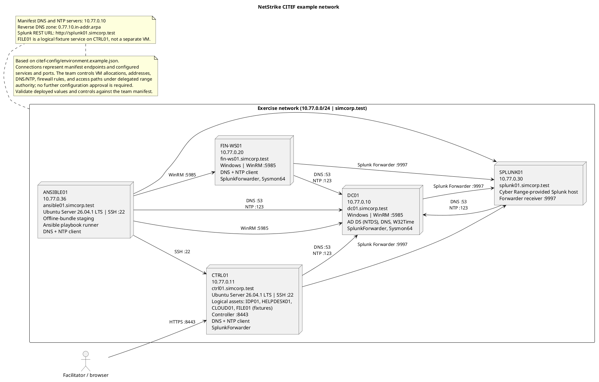

# CITEF provisioning

**Status (clarified 2026-10-31):** The Cyber Range has delegated full exercise VM and network configuration control to the team: allocations, images, sizing, addresses, DNS/NTP, firewall rules, management paths, and participant access do not await further range approval. The October 21 provisioning and DNS-blocking evidence is accepted for #79's tested configuration. Complete baseline and consecutive restore evidence remain separate; see the [validation report](../docs/offline-bundle-provisioning-validation.md).

## Authoritative guides

- [CITEF requirements and approval](../docs/exercise-design/06-citef-requirements-and-approval.md): confirmed requirements and approval decisions.
- [Offline tool-bundle inventory](../docs/exercise-design/07-offline-tool-bundle-inventory.md): selected artifacts, licensing, and test evidence.
- [Offline bundle guide](../docs/offline-bundle.md): bundle build, contents, integrity, and offline dependencies.
- [Safety and reset](../docs/exercise-design/04-safety-and-reset.md): isolation, stop, snapshots, readiness, and admission.
- [Portal deployment contract](../docs/application-deployment-contract.md) and [full-play deployment binding](../docs/full-play-deployment-binding.md): portal configuration, startup, and next-run handoff.

## Example topology



The [local network diagram](../docs/network-diagram/network-diagram-local.png) reflects `environment.local.json`. The team selects the actual images, addresses, sizing, and network policy under delegated authority; no additional CITEF allocation approval is required. Examples are not proof of deployed values: record those values in the private deployment manifest and validate target matches.

| Asset | Selected placement | Example address and DNS | Purpose |
|---|---|---|---|
| `CTRL01` | Ubuntu Server 26.04.1 LTS amd64 | `10.77.0.11`, `ctrl01.simcorp.test` | Staff controller, portal, event ledger, action adapters, and mock services |
| `ANSIBLE01` | Ubuntu Server 26.04.1 LTS amd64 | `10.77.0.36`, `ansible01.simcorp.test` | Ansible execution host and offline-bundle staging |
| `DC01` | Windows Server 2025 Evaluation Version, build 26100.32230 | `10.77.0.10`, `dc01.simcorp.test` | Synthetic AD, internal DNS, and isolated time source |
| `FIN-WS01` | Windows 11 Pro 26H2, build 2300.9457 | `10.77.0.20`, `fin-ws01.simcorp.test` | Participant endpoint and telemetry |
| `SPLUNK01` | Cyber Range-provided Splunk host | `10.77.0.30`, `splunk01.simcorp.test` | SIEM and forwarder receiver; range-provided, not a project-provisioned VM |
| `FILE01` | Logical service on `CTRL01`; not a separate VM | `ctrl01.simcorp.test` | Disposable fixtures and controller-managed known-good copy |

`ANSIBLE01` is excluded from Linux baseline provisioning so the playbook runner is not reconfigured as a target. Scenario VMs must not depend on Internet access. Patrick accepts the October 21 DNS-blocking method as sufficient #79 isolation evidence; this does not certify every possible egress path.

## Prepare and provision

Copy `environment.example.json` to the ignored `environment.json` and fill it with approved, non-secret values. The example is intentionally incomplete. The provisioning wrapper validates the manifest, verifies bundle integrity, installs pinned dependencies and collections offline, renders inventory, and runs the provisioning playbook.

Keep credentials in a private `secrets.yml` managed through an approved secret process; never commit it or put secret values in command arguments or logs. The wrapper copies this file into its extracted work directory, so use a fresh, access-restricted directory and a restrictive umask.

From the repository root on `ANSIBLE01`, run the wrapper with the two reviewed archives, manifest, secrets file, deployment version, unique run ID, and optional work directory, in that order:

```sh
umask 077
./provision.sh \
  netstrike-CTRL01-39599988130.tar.gz \
  offline-bundles.tar.gz \
  environment.json \
  secrets.yml \
  DASHBOARD_VERSION \
  UNIQUE_EXERCISE_RUN_ID
```

Use actual archive paths and path-safe deployment/run identifiers accepted by the playbook. Do not use example addresses or unapproved targets. The wrapper provisions `DC01`, Windows hosts, Linux baseline, and the controller; `SPLUNK01` is range-managed and is not configured by this project.

Approved deployments require the configured TLS material. Inject controller service credentials, readiness credentials, and audit keys through approved secret management; see the [portal deployment contract](../docs/application-deployment-contract.md) for required values and token roles. The offline package bundle includes Linux domain-enrollment and DNS/time prerequisites; use the [offline bundle guide](../docs/offline-bundle.md) for package or bundle issues.

## Restore and readiness

Follow the [safety and reset procedure](../docs/exercise-design/04-safety-and-reset.md). Capture clean snapshots after OS installation and remote-management setup, but before provisioning. After a restore, run the wrapper against the clean environment with a new unique run ID, then complete the documented readiness and admission checks.

Important scope: `provision.sh` runs `provision.yml` and its provisioning validation; it does **not** run the separate `readiness.yml` playbook. A successful wrapper run does not establish snapshot identity, emergency-stop reachability, complete Splunk ingestion, or participant admission. Patrick and exercise staff validate these controls; Zian/Julien assist or handle escalations, not a new configuration approval gate. Reuse the October evidence for what it shows; the consecutive-cycle criterion remains unmet. See the [baseline screenshot checklist](../docs/offline-bundle-provisioning-validation.md#baseline-evidence-to-capture).

For portal startup failures or run-ID recovery, follow the [deployment binding guide](../docs/full-play-deployment-binding.md). Do not remove portal state, reuse a run ID, or bypass preflight to force a restart. For receiver and Sysmon-to-Splunk setup, use the [Splunk/Sysmon ingestion guide](../docs/splunk-sysmon-ingest.md).
