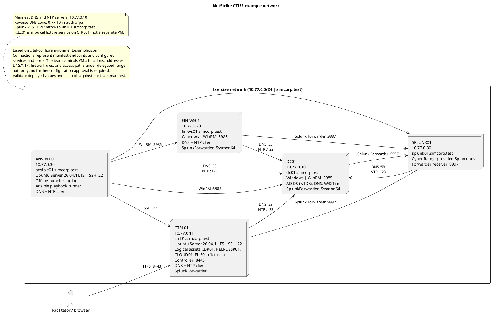

# CITEF provisioning

## Authoritative guides

- [CITEF requirements and approval](../docs/exercise-design/06-citef-requirements-and-approval.md): confirmed requirements and approval decisions.
- [Offline tool-bundle inventory](../docs/exercise-design/07-offline-tool-bundle-inventory.md): selected artifacts, licensing, and test evidence.
- [Offline bundle guide](../docs/deployment/offline-bundle.md): application bundle build, contents, integrity checks, offline Linux packages, and licensed-installer archive layout.
- [Safety and reset](../docs/exercise-design/04-safety-and-reset.md): isolation, stop, snapshots, readiness, and admission.
- [Portal deployment contract](../docs/deployment/application-deployment-contract.md): required portal configuration, TLS material, and credentials.
- [Full-play deployment runbook](../docs/deployment/full-play-deployment-guide.md): deployment steps and next-run handoff.

## Example topology



The [local network diagram](../docs/network-diagram/network-diagram-local.png) reflects `environment.local.json`. The team selects the actual images, addresses, sizing, and network policy under delegated authority; no additional CITEF allocation approval is required. Examples are not proof of deployed values: record those values in the private deployment manifest and validate target matches.

| Asset | Selected placement | Example address and DNS | Purpose |
|---|---|---|---|
| `CTRL01` | Ubuntu Server 26.04.1 LTS amd64 | `10.77.0.11`, `ctrl01.simcorp.test` | Staff controller, portal, event ledger, action adapters, and mock services |
| `ANSIBLE01` | Ubuntu Server 26.04.1 LTS amd64 | `10.77.0.36`, `ansible01.simcorp.test` | Ansible execution host and offline-bundle staging |
| `DC01` | Windows Server 2025 Evaluation Version, build 26100.32230 | `10.77.0.10`, `dc01.simcorp.test` | Synthetic AD, internal DNS, and isolated time source |
| `FIN-WS01` | Windows 11 Pro 26H2, build 2300.9457 | `10.77.0.20`, `fin-ws01.simcorp.test` | Participant endpoint and telemetry |
| `SPLUNK01` | Cyber Range-provided Splunk host | `10.77.0.30`, `splunk01.simcorp.test` | SIEM and forwarder receiver; range-provided, not a project-provisioned VM |

`FILE01` is implemented by Docker containers on `CTRL01`; it is not a separate
VM or asset entry.

`ANSIBLE01` runs the playbooks locally and must not appear in the manifest's
`assets`. `SPLUNK01` remains in the
manifest for DNS and receiver settings, but its inventory entry is commented
out. Neither host receives remote provisioning or service/clock validation
tasks. Readiness checks Splunk ingestion through its API from `localhost`;
forwarder configuration on exercise targets remains enabled.

## Prepare and provision

Copy `environment.example.json` to the ignored `environment.json` and fill it with approved, non-secret values. The example is intentionally incomplete. The provisioning wrapper validates the manifest, verifies bundle integrity, installs pinned dependencies and collections offline, renders inventory, and runs the provisioning playbook.

Keep credentials in a private `secrets.yml` managed through an approved secret process; never commit it or put secret values in command arguments or logs. The wrapper copies this file into its extracted work directory, so use a fresh, access-restricted directory and a restrictive umask.

From the repository root on `ANSIBLE01`, run the wrapper with the application bundle, licensed-installers archive, manifest, secrets file, deployment version, unique run ID, and optional work directory, in that order:

```sh
umask 077
./provision.sh \
  netstrike-CTRL01-39599988130.tar.gz \
  licensed-installers.tar.gz \
  environment.json \
  secrets.yml \
  DASHBOARD_VERSION \
  UNIQUE_EXERCISE_RUN_ID
```

Use actual archive paths and path-safe deployment/run identifiers accepted by the playbook. Do not use example addresses or unapproved targets. The wrapper provisions `DC01`, Windows hosts, Linux baseline, and the controller; `SPLUNK01` is range-managed and is not configured by this project.

To deploy only the controller service and its forwarder input app on an already
provisioned controller, use `scripts/provision_controller.sh` instead. It takes
the application bundle, controller IP, environment manifest, secrets file,
deployment version, exercise run ID, and optional work directory. The supplied
IP must match the manifest's `CTRL01` address. The script runs
`controller_service.yml`; it does not provision the host baseline or other
exercise machines. It still requires the existing Universal Forwarder and the
controller credentials described below. `environment.json` remains required
because the playbook loads it for controller configuration and validates it
before deployment.

```sh
umask 077
./scripts/provision_controller.sh \
  netstrike-CTRL01-39599988130.tar.gz \
  10.77.0.11 \
  environment.json \
  secrets.yml \
  DASHBOARD_VERSION \
  UNIQUE_EXERCISE_RUN_ID \
  ./offline-controller
```

Use the approved manifest and path-safe deployment/run identifiers. Keep the
secrets file private and use a fresh, access-restricted work directory.

For portal TLS, service/readiness credentials, audit keys, and required values,
follow the [portal deployment contract](../docs/deployment/application-deployment-contract.md).
For application-bundle contents, offline Linux packages, and licensed-installer
archive layout, see the [offline bundle guide](../docs/deployment/offline-bundle.md).

## Restore and readiness

Follow the [safety and reset procedure](../docs/exercise-design/04-safety-and-reset.md). Capture clean snapshots after OS installation and remote-management setup, but before provisioning. After a restore, run the wrapper against the clean environment with a new unique run ID, then complete the documented readiness and admission checks.

`provision.sh` runs `provision.yml` and its provisioning validation; it does
**not** run the separate `readiness.yml` playbook. Provisioning alone does not
establish snapshot identity, emergency-stop reachability, Splunk ingestion, or
participant admission. Use the [validation report](../docs/deployment/offline-bundle-provisioning-validation.md)
and [baseline evidence checklist](../docs/deployment/offline-bundle-provisioning-validation.md#baseline-evidence-to-capture)
for the corresponding evidence.

For portal startup failures or run-ID recovery, follow the [full-play deployment runbook](../docs/deployment/full-play-deployment-guide.md). Do not remove portal state, reuse a run ID, or bypass preflight to force a restart. For receiver and Sysmon-to-Splunk setup, use the [Splunk/Sysmon ingestion guide](../docs/deployment/splunk-sysmon-ingest.md).
