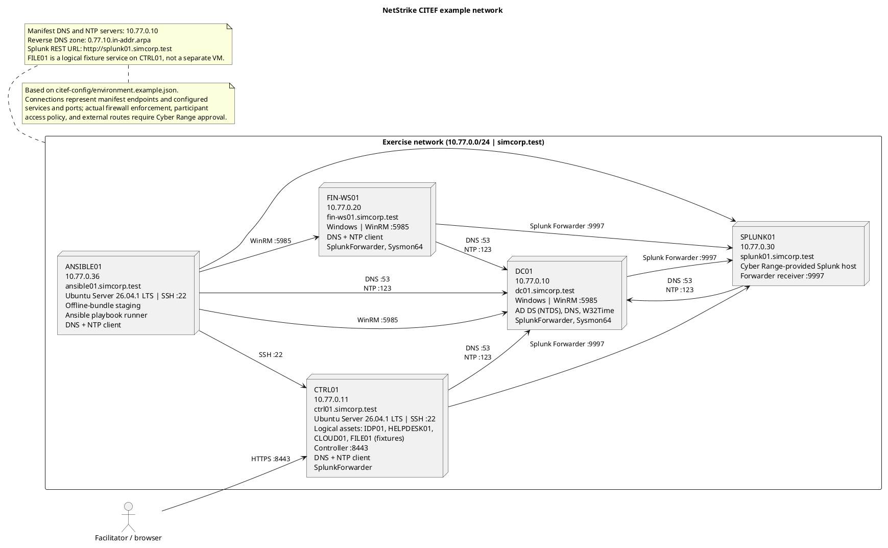

# CITEF topology and Ansible workflow

**Status (2026-10-15):** Proposed configuration; not approved for CITEF
deployment. A local provisioning rehearsal is recorded in
[the October 15 report](../docs/20261015%20Offline%20Bundle%20and%20Provisioning%20Validation.md).
It did not configure or restore a CITEF environment.

## Sources of truth

- [CITEF requirements and approval](../docs/exercise-design/06-citef-requirements-and-approval.md)
  is the decision record for confirmed requirements, open questions, and
  approval.
- [Offline tool-bundle inventory](../docs/exercise-design/07-offline-tool-bundle-inventory.md)
  records selected artifacts, licensing dispositions, and test evidence.
- [Offline bundle guide](../docs/offline-bundle.md) describes the CI artifact
  build, integrity checks, and application smoke test.
- [Safety and reset](../docs/exercise-design/04-safety-and-reset.md) defines
  exercise-wide stop, snapshot, and admission rules. This guide covers the
  Ansible-specific manifest and playbooks only.

## Proposed topology



The diagram and addresses below are planning examples, not approved host
assignments, routes, firewall rules, or management interfaces. Confirm the
images, network ranges, and access paths with CITEF before using the manifest.

| Asset | Proposed placement | Example address and DNS | Purpose |
|---|---|---|---|
| `CTRL01` | Ubuntu Server 26.04 amd64 | `10.77.0.11`, `ctrl01.simcorp.test` | Staff controller, portal, event ledger, action adapters, and mock services |
| `DC01` | Windows Server 2025 LTSC | `10.77.0.10`, `dc01.simcorp.test` | Synthetic AD, internal DNS, and isolated time source |
| `FIN-WS01` | Windows 11 Pro or Enterprise 26H2 | `10.77.0.20`, `fin-ws01.simcorp.test` | Participant endpoint and telemetry |
| `SPLUNK01` | CITEF-managed Splunk Enterprise 10.0.1 | `10.77.0.30`, `splunk01.simcorp.test` | SIEM; 10 GB/day ingestion and 300 GB disk limits |
| `FILE01` | Logical service on `CTRL01`, or a separately approved Linux VM | Not assigned | Disposable fixtures and controller-managed known-good copy |

`FIN-WS01` must use Windows Pro or Enterprise because it joins the exercise
Active Directory domain; Windows Home cannot join a domain.

Linux hosts managed by `linux_baseline` also join the exercise domain. The role
installs the offline-bundled Ubuntu 26.04 `realmd`, `adcli`, and SSSD packages
without network access, places the computer account in
`identity_baseline.search_base_dn`, and uses the injected domain administrator
credentials without logging the password.

For Linux joins, bare administrator names and `DOMAIN\user` or `DOMAIN/user`
names are passed to `realmd` as an unqualified account name so it selects the
discovered Kerberos realm. Explicit `user@REALM` names are preserved; their realm
must match the directory's Kerberos configuration (normally the uppercase AD
DNS domain). Appending a lowercase DNS domain to an account can cause
`Couldn't get kerberos ticket: KDC reply did not match expectations`.
The `Password for ...:` prompt is normal even when the password is supplied
through stdin; it does not by itself indicate missing credentials. If a join
still fails, inspect `sudo journalctl -u realmd --since '15 minutes ago' --no-pager`
on the target for the underlying error rather than disabling password redaction.

The same offline package bundle includes `systemd-resolved` and `chrony`.
The role installs these prerequisites before configuring or starting DNS and time
services; minimal images need not have them preinstalled. If provisioning reports
`Could not find the requested service systemd-resolved`, use this updated role
and rebuild and transfer the offline bundle so it contains both packages and
their dependencies. Older bundles containing only membership packages are
insufficient; no Internet-enabled package installation is required on the target.

The local October 15 rehearsal used Ubuntu Server 26.04.1 for `CTRL01` and
Windows 11 26H2 for `FIN-WS01`. Its personal-network addresses and credentials
are intentionally omitted. `DC01` and the Splunk host were not configured in
that rehearsal. The tested images do not establish CITEF image approval.

Keep the controller, domain controller, participant endpoint, and Splunk on
separate VMs. Project-owned Linux services may share `CTRL01`; `FILE01` may be
separate only if CITEF approves the additional VM. The example exercise subnet
is `10.77.0.0/24`; `10.77.1.0/24` is a proposed management subnet. Confirm
non-overlap and actual allocations with CITEF. Scenario VMs must not have an
Internet path.

## Prepare and validate the manifest

Copy `environment.example.json` to the ignored `environment.json` and replace
the example values with approved, non-secret configuration. Do not commit the
local manifest. It contains Ansible and inventory inputs, not approvals,
snapshot IDs, or credentials.

The JSON Schema validates fields, types, enumerations, and formats.
`validate_environment.py` adds cross-field checks for network membership and
overlap, asset mappings, DNS/domain relationships, artifact paths, and
endpoint/port consistency. Both validation and inventory rendering apply these
checks. The checked-in example is intentionally incomplete and must fail
validation until the range-owned values and staged artifact paths are supplied.

`identity_baseline.users` is the intended exact set of domain users, including
enabled state and memberships. The current `readiness.yml` does **not** compare
that AD baseline: its domain-controller play is disabled while `DC01` is
unavailable. Do not describe AD readiness as verified until that play is
enabled, tested, and its result recorded.

Validate and render the ignored inventory from `citef-config/`:

```sh
python3 validate_environment.py validate --config environment.json
python3 validate_environment.py inventory --config environment.json > inventory.ini
```

Install the validator requirement from the bundle wheelhouse using the same
Python interpreter that runs validation:

```sh
python3 -m pip install --no-index \
  --find-links ../offline-bundles/CITEF-RELEASE/netstrike-offline-bundle/destinations/CTRL01/wheelhouse \
  -r requirements-validator.txt
```

Install the controller requirements from the same wheelhouse into the Python
environment used by `ansible-playbook`:

```sh
python3 -m pip install --no-index \
  --find-links ../offline-bundles/CITEF-RELEASE/netstrike-offline-bundle/destinations/CTRL01/wheelhouse \
  -r requirements-controller.txt
```

Use the bundle's pinned local Python requirements and collection archives as described in the
[offline bundle guide](../docs/offline-bundle.md); do not fetch packages or
collections from the Internet on the target network.

The generated inventory does not contain account names or passwords. Supply
approved SSH/WinRM credentials through Ansible Vault or another approved secret
manager, for example a private vars file passed with `-e @secrets.yml`.
Never put credentials in the manifest, shell history, or repository. Inject
`NETSTRIKE_READINESS_TOKEN` and `SPLUNK_TOKEN` into the Ansible process
environment for readiness checks. Each configured Splunk probe must include
`{run_id}` and return its configured `expected_event_id`.

For isolated tests only, the manifest may omit the Universal Forwarder receiver
CA and controller TLS certificate/CA: forwarder traffic is plaintext, the
controller uses a short-lived self-signed certificate, and Splunk REST skips
certificate verification. These settings are not approved deployment
configuration. Approved runs require certificates; `tls_certificate` and
`tls_ca` must be set together.

## Provisioning

Before changing hosts, `provision.yml` validates the manifest and staged vendor
artifact hashes. It currently configures workstations and Windows telemetry,
the Linux baseline, the controller portal, and controller telemetry.
`DC01` provisioning is disabled in the playbook while the host is unavailable;
`SPLUNK01` is not configured by the project playbook. Do not treat the current
playbook as complete range deployment.

The domain-controller role always sets DC01's system clock from the Ansible
controller's UTC clock before installing Active Directory, then configures
DC01's time service according to the selected NTP settings. Keep the controller
clock accurate before provisioning; this is a one-time clock set, not ongoing
synchronization.

The Windows Universal Forwarder restart handler waits up to 120 seconds for
shutdown before starting the service, then up to 120 seconds for it to reach
Running. This accommodates slow shutdowns that can otherwise report
`Cannot stop SplunkForwarder service on computer` even though the service stops
shortly afterward. Timeouts and service-control errors still fail provisioning;
check the Windows Service Control Manager and Splunk logs if they persist.

The controller application now defaults to the full-play scenario. Set
`controller_scenario_scope=identity` or `cloud` only for an explicitly scoped
test. The controller and all forwarders receive the same `exercise_run_id`;
after a portal-only reset changes that ID, Prepare/Start remain blocked until
the approved clean deployment/forwarder handoff is completed. See
[full-play deployment binding](../docs/full-play-deployment-binding.md).

Inject `controller_service_tokens`, `controller_readiness_token`,
`controller_identity_audit_key` (32 or more characters), and
`controller_tls_private_key_pem` through approved secret management. The
readiness token must be one of the service-token keys and must map to a
facilitator role. Keep secrets outside Git or encrypt them with Ansible Vault.

The role renders the current [portal environment contract](../docs/application-deployment-contract.md):
the persistent database, reviewed profile and selected scenario paths, scope
guard, shared portal/host run ID, dedicated disposable impact root, audit key,
exact SSO origin allowlist and role-token mapping. Set
`controller.sso_allowed_origins` in the approved environment manifest to the
actual browser-facing origin, including its scheme and port. This is a JSON
array in the application environment, not a comma-separated string.

### Portal startup and recovery

Ansible writes all portal configuration, source, dependencies, certificates and
the systemd unit **before** the first start, then starts the portal once. The
role never restarts a portal: full-play startup creates the run fixture, and a
second start with the same run ID would correctly fail `disposable_impact_root`
validation. If the portal is already running, a rerun leaves it untouched and
warns that changed configuration is not applied; if it is stopped and the run
fixture already exists, the play fails with a request for a new run ID.
The spool timer is enabled only after authenticated local readiness confirms
the requested `exercise_run_id` and application baseline.

The unit runs read-only preflight under the same service identity, working
directory and protected environment as the application, then starts exactly
one Uvicorn worker. Automatic process restart is disabled: neither full-play
fixtures nor the retained SQLite ledger implement crash-resume. A failed
process must not loop or erase evidence to manufacture a successful startup.
Changing configuration/source on an existing run is not a supported live
upgrade; use the approved clean-snapshot/new-run procedure.

For a startup failure, inspect `sudo systemctl status netstrike-portal.service`
and `sudo journalctl -u netstrike-portal.service -b --no-pager` on CTRL01.
Preflight prints safe blocker IDs; do not print or copy
`/etc/netstrike/controller.env` into diagnostics. In particular,
`disposable_impact_root` after an earlier startup can mean that the run fixture
already exists, not that another environment variable is missing. Preserve the
database, fixtures and spools, export available staff evidence, then follow the
[coordinated restore and new-run handoff](../docs/full-play-deployment-binding.md#reset-and-next-run-admission).
Do not remove state, reuse a run ID, or bypass preflight to force a restart.
Local readiness still does not prove Splunk ingestion or authorize admission.

### Bundle selection and provisioning command

By default, the controller and Linux baseline roles read the extracted bundle from
`<offline_artifacts.directory>/netstrike-offline-bundle`. If it is extracted
elsewhere, set `controller_offline_bundle_root` to the absolute path containing
`runtime/` and `destinations/` on the machine running Ansible, for example
`/srv/offline-bundle/netstrike-offline-bundle`. Both roles honor this override;
Linux domain packages are read from
`<controller_offline_bundle_root>/destinations/CTRL01/linux-packages/`.
Keep `offline_artifacts.directory` pointing at the separately staged vendor
artifacts (such as `offline-bundles/CITEF-RELEASE`); it need not be changed to
select the extracted bundle. Supply the override in your extra-vars file or as
`--extra-vars "controller_offline_bundle_root=/srv/offline-bundle/netstrike-offline-bundle"`.
Run Ansible from this directory so its pinned
configuration, roles, collections, and local manifest are used:

```sh
ansible-playbook \
  -i inventory.ini \
  playbooks/provision.yml \
  -e @secrets.yml \
  --extra-vars "deployment_version=DASHBOARD_VERSION" \
  --extra-vars "exercise_run_id=UNIQUE_EXERCISE_RUN_ID"
```

Provision only after independent review of the manifest, images, bundle,
external artifacts, TLS material, secrets, and CITEF approvals. The example
values are not deployable.

For a standalone Windows telemetry test, Ansible can prompt for the inventory
account password:

```sh
ansible-playbook \
  -i inventory.ini \
  playbooks/windows_telemetry.yml \
  --user 'DOMAIN\username' \
  --ask-pass
```

Use NTLM over HTTP only on an isolated, approved management network; otherwise
use CITEF's approved WinRM transport and protection. For receiver setup and
Sysmon-to-Splunk verification, follow the
[Splunk/Sysmon ingestion guide](../docs/splunk-sysmon-ingest.md).

## Post-restore readiness

The complete restore/admission procedure is in
[safety and reset](../docs/exercise-design/04-safety-and-reset.md). The
Ansible readiness playbook is read-only except for sending its configured test
events; it checks manifest validity, host connectivity and identity, OS family,
DNS, clock skew/synchronization, required services, local application readiness,
and run-correlated Splunk probes. It excludes `DC01` and does not currently
verify the AD identity baseline. The local application endpoint explicitly
reports application-only scope; it is not a CITEF readiness certificate.

After the approved snapshot restore, inject the secrets and use a new unique
run ID:

```sh
ansible-playbook \
  -i inventory.ini \
  playbooks/readiness.yml \
  -e @secrets.yml \
  --extra-vars "exercise_run_id=NEW_UNIQUE_RUN_ID"
```

Separately verify network policy, snapshot identity, and emergency-stop
reachability with the range operator. A local manifest check, playbook result,
or application readiness response cannot attest to those controls. The
October 15 local rehearsal did not restore snapshots or establish CITEF
readiness; see its [validation report](../docs/20261015%20Offline%20Bundle%20and%20Provisioning%20Validation.md).

## Local tests

With `jsonschema` installed from the offline wheelhouse, run:

```sh
python3 -m unittest discover -s tests -v
```

Ansible syntax and live-target checks require the approved runtime,
collections, complete local manifest, and authorized targets. Do not test
against guessed or example addresses.
