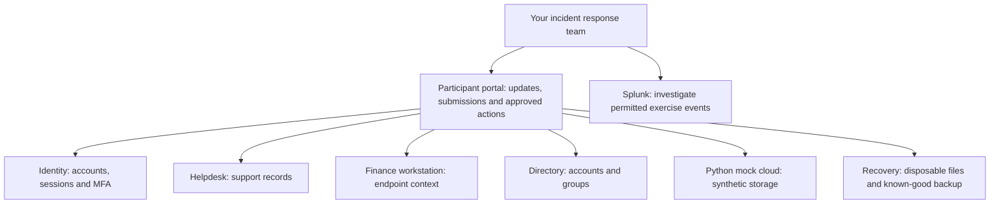

# Operation Silent Spider — participant quick reference

Working draft, 14 October 2026. Exercise staff must complete the access details
and approve the short policy cards before distributing this handout.
No solution, branch criteria or hidden checkpoint schedule is included.

## Your session

- You are SimCorp's incident response team. All scenario identities/data are synthetic.
- Schedule: 15-minute briefing + 130-minute play + 25-minute debrief = 170 minutes.
- Wait for the facilitator's start announcement. Stop actions when play ends.
- Share investigation, response and note-taking work; your access permissions are assigned separately.
- Aim to triage the incident, reconstruct events, contain access, assess mock-cloud exposure, and recover/communicate honestly.
- Anyone can call **STOP EXERCISE**. Stop actions, preserve the current screens/files, and contact the facilitator directly. Never wait for the help queue during a safety concern.

## Access card — exercise staff complete before delivery

| Item | Your assigned value |
| --- | --- |
| Session/team label (on this handout, not a portal banner) | [TEAM_LABEL] |
| Run ID | [RUN_ID] |
| Participant portal | [PORTAL_BASE_URL]/participant |
| Local synthetic evidence viewer — not Splunk | [PORTAL_BASE_URL]/evidence |
| Splunk URL/shortcut and app | [SPLUNK_URL_OR_SHORTCUT]; [SPLUNK_APP] |
| Private credential delivery and authorized response role(s) | [CREDENTIAL_METHOD_AND_ROLES] |
| Approved scope: subnet, hosts and writable evidence location | [APPROVED_SCOPE]; [EVIDENCE_DIRECTORY] |
| Splunk absolute time window and displayed time zone | [SPLUNK_UTC_WINDOW]; [SPLUNK_DISPLAY_TIME_ZONE] |
| Validated learner base search (copy exactly) | [SPLUNK_LEARNER_BASE_SEARCH] |
| Application event-ID field in Splunk | [APP_EVENT_ID_FIELD] |
| Ordinary team/status-update channel | [TEAM_UPDATE_CHANNEL] |
| Facilitator, urgent safety contact and backup contact method | [FACILITATOR_NAME]; [SAFETY_CONTACT]; [BACKUP_CONTACT] |
| Session start/end and arrangements for a break | [SESSION_TIMES_AND_BREAK_ARRANGEMENT] |

Never put passwords or tokens into screenshots, evidence notes, help messages or
shared reports. Contact staff if credentials fail; don't use a staff token.

## SimCorp context and conceptual service map

SimCorp is preparing a quarterly customer billing export. Sarah Mitchell is
VP of Finance, Tyler Brennan works at the helpdesk, and Rebecca Nwosu is
Director of IT. Treat witness statements as statements to verify against evidence.
All conversations with simulated people go through exercise control.



This is a conceptual map, not firewall rules, attack paths or a confirmed VM
layout. The seven service areas are identity, helpdesk, workstation, directory,
mock cloud, recovery and Splunk; the portal is your interaction layer. Several
services may share one VM. Portal actions affect the simulation; they do not
promise direct administration of real Windows/AD. Splunk's configured event
coverage must be confirmed by staff. No Internet access is required for play.

## Rules and short policy cards

Use only assigned exercise targets and approved controls. Preserve evidence
before disruptive remediation. Don't alter original logs, scan outside scope,
contact real people, install unapproved tools, disable isolation, change Splunk
or controller settings, or touch snapshots. Never encrypt/erase real data.

The following fictional policy cards are proposed participant-facing text for
Anna's approval, not evidence of additional implemented features:

- **Identity/access:** use only your assigned permissions. Coordinate disruptive account changes with the incident lead, document the reason, and verify the effect. Never share scenario credentials or approve unexpected MFA requests without verification.
- **Helpdesk verification:** password/MFA reset requests require the approved verification and callback process using a trusted route supplied by exercise control—not contact details supplied by an unverified caller. Record the verification steps. Urgency or knowledge of someone's manager is not identity verification.
- **Data handling:** preserve original artifacts. Store exports/copies only in the approved evidence folder, record their source/time and hash where relevant, and share them only through approved exercise channels. Use synthetic data only.
- **Escalation:** tell the incident lead about new scope, business impact or uncertainty. Route simulated management/legal/witness questions through the facilitator. Communicate confirmed facts separately from hypotheses; report safety issues immediately.

## Using the portal

1. Open `/participant`, enter **Exercise access token**, and select **Connect**.
   Check **Run ID** against your access card before acting.
2. Read **Situation updates**; use **Refresh** when needed. There is no
   acknowledgement button. Acknowledge/status-update through the assigned channel.
3. Use **Open evidence timeline** for the local read-only viewer. Connect there
   with your participant token. Filter by signal type or text; copy evidence IDs.
4. Use **Approved containment actions** only with evidence-supported target IDs
   and your authorized role. Inspect current evidence after an action. A receipt
   does not by itself prove that the attack path was blocked.
5. Expand **Ask exercise staff for help**, select the related objective and
   **Send help request**. Staff answer manually; **Refresh replies** checks for a
   reply. Threads are private to the requester and staff, not the whole team.
   Wait for an answer before asking another question. Help is recorded for human
   review, not automatically scored. No guaranteed response time is promised.
6. Request unsupported but valid simulated actions through help or the agreed
   facilitator channel. State the intended action, target, reason and evidence.
   Staff confirmation is required; submitting a question does not execute it.

No arbitrary file uploads, generic status-update form, team-name banner or
dedicated simulated-action button currently exists. Use the supplied alternatives.
If an action/submission response is lost, refresh/inspect and ask staff before
repeating it. A missing response can follow a successful action. Drafts are not
saved submissions; record important notes in the approved folder. An observed
new run or changed credential clears old drafts—check the Run ID again.

## What to record and submit

### 1. Initial assessment — built into the portal

Complete **Initial assessment** and select **Submit assessment**:

- Affected identity: `[name or account supported by evidence]`
- Classification: `[your current assessment]`
- Evidence reference/source 1: `[event, ticket or artifact ID] / [source]`
- Evidence reference/source 2: `[event, ticket or artifact ID] / [source]`
- Evidence reference/source 3: `[event, ticket or artifact ID] / [source]`

Use at least three relevant references from at least two sources. Keep confidence,
alternative explanations and next actions in your team notes/status update.
The portal records references, not attached evidence files.

### 2. Intrusion timeline — built into the portal

Expand **Submit your intrusion timeline**. Complete at least six significant
entries in occurrence order; **Add event** supports up to 12. Select **Submit timeline**.

| Occurrence time, with zone | Supporting event ID | What happened | Statement type |
| --- | --- | --- | --- |
| [ISO 8601, preferably UTC ending in Z] | [current-run event ID] | [evidence-supported statement] | Observed fact / Analyst inference |

Repeat the row for each event. Cite the actual event ID, not a Splunk search job
ID or ingestion sequence. If an inference rests on several artifacts, cite a
supporting event in the form and retain the additional references in team notes.
Record what happened when, not when a message appeared or you discovered it.
Portal message times may display in browser-local time; normalize notes to UTC.
Elapsed exercise-clock time is not an incident occurrence timestamp.

### 3. Cloud exposure assessment — built into the portal when available

Use **Refresh cloud evidence**, inspect **Current objects and access controls**,
and complete **Cloud assessment**:

- **Affected service principal:** `[principal identified from actual audit]`
- **Confirmed records accessed:** `[unique synthetic records supported by audit]`
- **Evidence conclusion:** choose **Insufficient evidence**, **Mock access confirmed; external transfer not established**, or **External transfer proven**, according to what the evidence actually establishes.
- **Cloud audit event IDs (one per line):** `[current-run audit IDs]`

Select **Submit cloud assessment**. Keep the bucket, relevant key ID, scope
limitations, preservation and containment actions/results in your team notes;
there is no separate bucket or narrative field in this form. Do not count retries
or repeated reads of the same record as additional unique records. Zero confirmed
records is not a claim that no exposure was possible. A threat claim or local mock
read alone does not establish real external transfer. Refresh after containment
to verify the actual state and subsequent outcomes.

### 4. Final incident brief — built into the recovery section when available

Complete **Final incident brief** and select **Submit incident brief** before play ends:

- **Confirmed scope:** `[affected identities, hosts and services; supported facts]`
- **Confirmed cloud records:** `[evidence-supported count consistent with your assessment]`
- **Business impact:** `[what was unavailable/affected and what remains uncertain]`
- **Actions taken:** `[containment/recovery actions and verified outcomes]`
- **Remaining risk and uncertainty:** `[access, evidence gaps and follow-up needs]`
- **Two prioritized follow-up recommendations (one per line):** `[priority, action, suggested owner and reason]`
- **Recovery audit event IDs (one per line):** `[current-run events supporting recovery/validation]`

Recovery begins with **Preview only — do not execute** checked. A preview is not
a completed restore or health check. Review it, deliberately execute only approved
operations when appropriate, then run and inspect an actual **Validate hashes**
result before claiming recovery. Use the evidence's logical fixture ID, not a path.

### Working evidence and decision log — approved folder, not a separate portal form

| UTC time | Person | Decision/action and target | Evidence/reason | Result or uncertainty |
| --- | --- | --- | --- | --- |
| [time] | [exercise role/name] | [what you chose] | [event/artifact IDs] | [verified result or still unknown] |

For a preserved artifact, also record the original source, occurrence/collection
times, approved copy location, collection method and SHA-256 when appropriate.
Keep original logs unchanged. If the portal fails, retain these templates offline
and contact staff. Notes are not automatically imported or treated as a successful
portal submission; staff must record the fallback and its timing explicitly.

## Neutral Splunk navigation examples

Patrick must replace every placeholder and verify these with the actual learner
role before use. `BASE_SEARCH` below means the supplied complete, run-scoped
learner search—not literal SPL, a dashboard token, or permission to search all indexes.
Use the approved absolute time window, including pre-exercise history. These
examples teach navigation, not which incident events to find.

Show events:

```spl
BASE_SEARCH
```

Count available events by source type:

```spl
BASE_SEARCH
| stats count by sourcetype
```

Inspect neutral metadata for matching events:

```spl
BASE_SEARCH
| table _time host source sourcetype
```

Expand an event to inspect its raw fields and copy the approved event-ID field.
Summary counts and displayed tables are investigation views, not a guarantee of
complete exported evidence. Ask staff which export method to use for preservation.
If events are missing, check the time window/run scope and report the issue. Don't
remove access filters or search staff-only data. A typed `visibility` filter is
not a substitute for permissions enforced by the deployment.

Generic navigation/SPL references: official Splunk Enterprise 10.0
[time picker](https://help.splunk.com/en/splunk-enterprise/search/search-manual/10.0/specify-time-ranges/select-time-ranges-to-apply-to-your-search),
[stats](https://help.splunk.com/en/splunk-enterprise/search/search-manual/10.0/calculate-statistics/use-the-stats-command-and-functions),
and [table](https://help.splunk.com/en/splunk-enterprise/spl-search-reference/10.0/search-commands/table).
These do not establish the range's actual field extraction or event arrival.
Keep the completed handout available offline; links are optional author references.

## At the end

Stop technical actions on the facilitator's instruction. Hand over the agreed
team notes/exports through the approved channel. Don't reset VMs or delete evidence.
During the 25-minute debrief, discuss your reasoning, what worked, uncertainty,
what you would change, and any problems with the exercise itself. Staff review
the five objectives using evidence and context; there is no public leaderboard
or automatic numeric grade in the current application.
