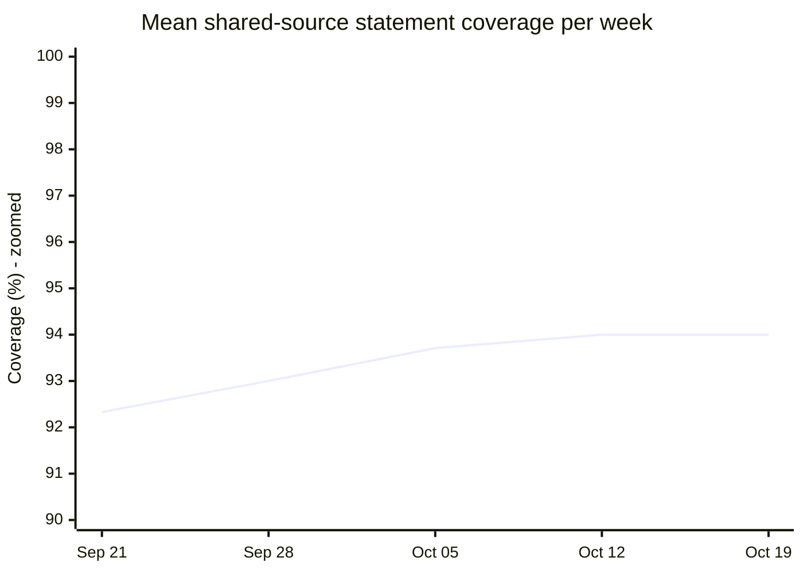
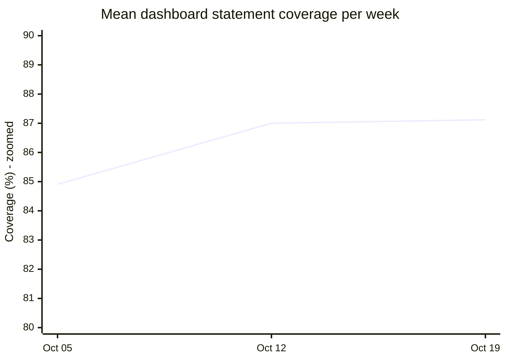
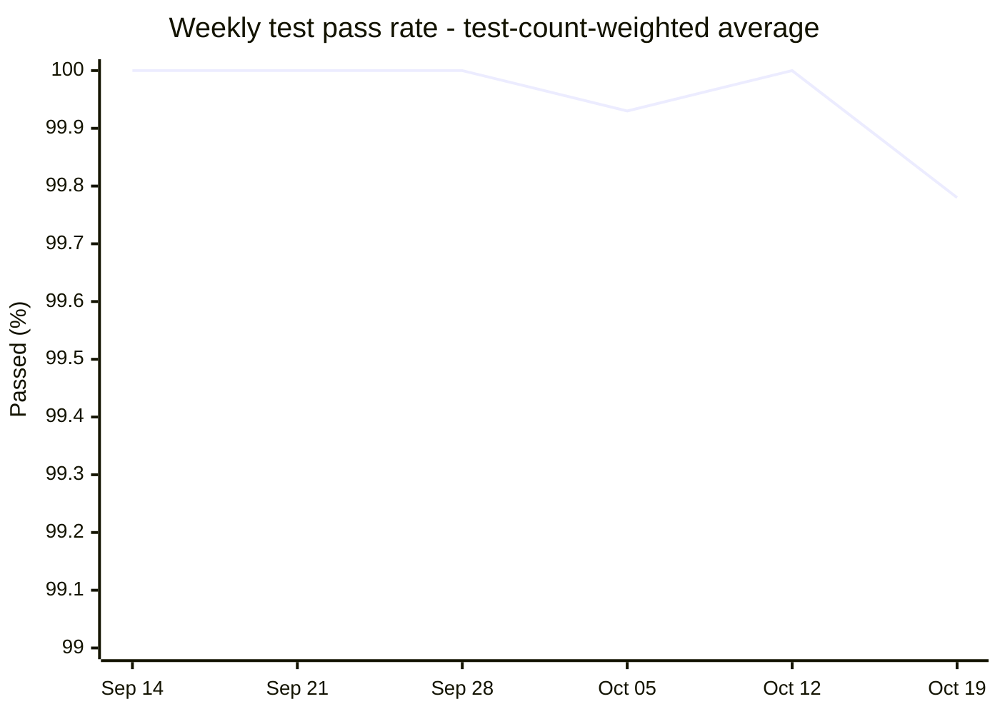
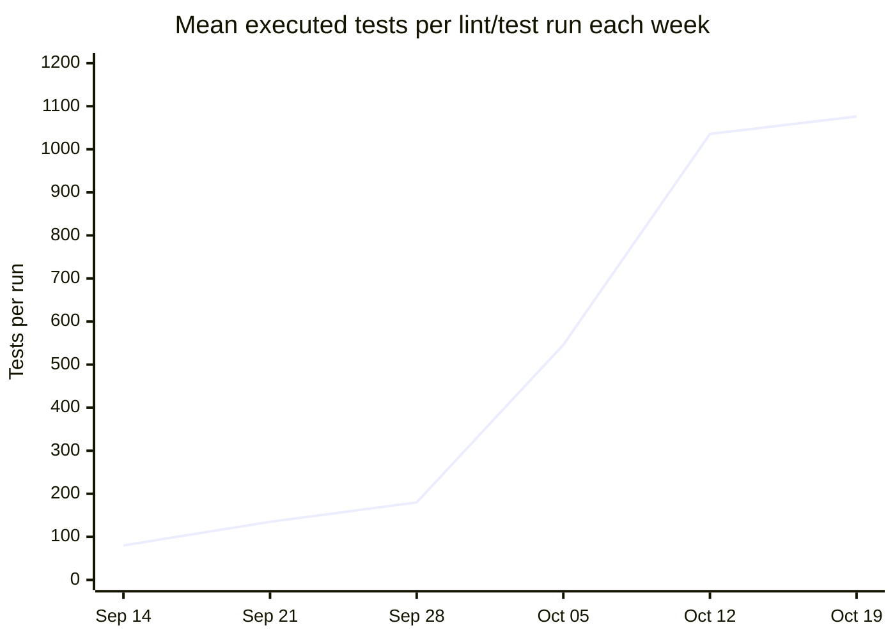
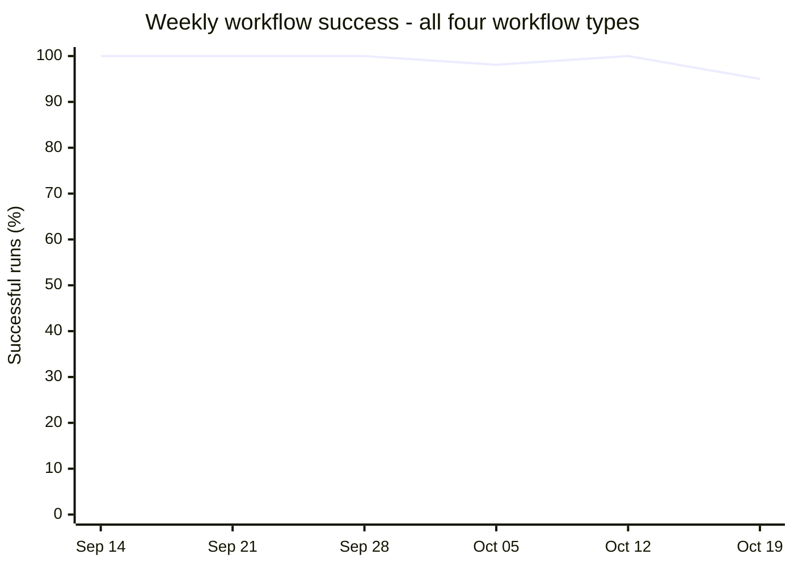

# CI/CD quality trends since September 1

**Period: September 1-October 19, 2026, through 22:45:36 UTC.** Weekly mean
shared-source statement coverage increased from **92.33% to 94.00%**.
Weekly test pass rates ranged from **99.78% to 100%** among reported test
outcomes; early collection errors and one interrupted session limit completeness.
Weekly workflow success ranged from **95% to 100%**.

These are historical timeline charts, not a single-commit report or a live
dashboard. Weeks run Tuesday-Monday, starting September 1. Missing observations
are **N/A**, never zero, and are omitted from chart lines. There are no returned
workflow runs for September 1-7; the earliest returned run is September 14.

Test and coverage aggregates consider **all 150 completed, non-cancelled
Lint and Test runs**, including failed runs, across all branches and push/PR
events. Two cancelled lint/test runs are excluded. These are weekly
aggregates, not endpoint samples. Each run is assigned by its creation date
in UTC, even if its jobs finish later.

## Code coverage over time

The shared event-contract job consistently selects `--source=shared`, making
it the available multi-week production-source coverage series. Each point is
the **arithmetic mean of all available reported percentages for that scope
in that week**, with equal weight per run/report, not an average across
different modules. Chart dates are **week endings**.

| Week ending | Eligible lint/test runs | Shared reports | Mean shared coverage |
|---|---:|---:|---:|
| Sep 07 | 0 | 0 | N/A |
| Sep 14 | 2 | 0 | N/A |
| Sep 21 | 17 | 15 | 92.33% |
| Sep 28 | 2 | 2 | 93.00% |
| Oct 05 | 82 | 79 | 93.71% |
| Oct 12 | 22 | 22 | 94.00% |
| Oct 19 | 25 | 25 | 94.00% |

Retained module artifacts provide three weeks of dashboard and orchestrator
observations and two weeks for the remaining modules. Missing reports are
excluded, not assumed to match another run. Each table cell shows the mean
and the number of available reports; these can be less than the eligible
run count.

The coverage axes are zoomed to 90-100% for shared-source coverage and
80-90% for dashboard coverage to make changes over time easier to see.

| Module report | Week ending Oct 05 | Week ending Oct 12 | Week ending Oct 19 |
|---|---:|---:|---:|
| OSINT profiler | N/A | 66.00% (22) | 66.00% (25) |
| MFA fatigue simulation | N/A | 84.00% (22) | 84.00% (25) |
| Lateral movement | N/A | 76.00% (22) | 76.00% (25) |
| Cloud exfiltration | N/A | 83.00% (22) | 83.00% (25) |
| Ransomware simulation | N/A | 83.00% (22) | 83.00% (25) |
| Orchestrator | 86.35% (71) | 87.00% (22) | 87.00% (25) |
| Dashboard | 84.91% (67) | 87.00% (22) | 87.12% (25) |

Coverage is rounded **statement coverage**, not branch coverage. Module
reports include executed tests and imported code and can omit unexecuted
production files; unlike the shared job, they do not select an explicit
production-source scope. Code and test inventories also change over time.
Weekly means use the already-rounded report percentages, so decimal places
describe the average, not extra precision in the original measurement.
Do not average different modules together or combine overlapping statement
totals: **there is no measured repository-wide coverage percentage**.
No numeric coverage minimum is configured. Module artifacts have 14-day
retention; expired/missing artifacts cannot establish a historical value.
Coverage means describe available reports, not necessarily every eligible run.

## Test pass rate and test volume over time

Each pass-rate point is **total passed / (total passed + total failed)**
across that week's eligible runs. This is a test-count-weighted average:
a run reporting 1,000 tests contributes ten times the weight of one reporting
100 tests. Repeated executions count each time; these are not unique test cases.
Skips, subtests, and collection errors are excluded from the denominator.

The volume chart is **mean executed tests per eligible run**, counting passed
and failed outcomes. A September 29 run explicitly reported no test directories
and contributes zero volume, not a fictitious passing result. One October 5
dashboard session was interrupted before its summary; its unreported outcomes
cannot be counted. Other jobs in that run still contribute their summaries.
The pass-rate axis is zoomed to show small changes.

| Week ending | Runs | Passed | Failed | Collection errors | Test pass rate | Mean tests/run |
|---|---:|---:|---:|---:|---:|---:|
| Sep 07 | 0 | N/A | N/A | N/A | N/A | N/A |
| Sep 14 | 2 | 160 | 0 | 2 | 100.00%* | 80.00 |
| Sep 21 | 17 | 2,293 | 0 | 12 | 100.00%* | 134.88 |
| Sep 28 | 2 | 360 | 0 | 0 | 100.00% | 180.00 |
| Oct 05 | 82 | 44,730 | 33 | 0 | 99.93%** | 545.89 |
| Oct 12 | 22 | 22,784 | 0 | 0 | 100.00% | 1,035.64 |
| Oct 19 | 25 | 26,846 | 58 | 0 | 99.78% | 1,076.16 |

**\* Incomplete collection:** all 2 September 14 runs and 12 of the 17
September 21 runs had collection errors. Their 100% describes only tests with
reported pass/fail outcomes, not a fully passing suite. **\*\* Incomplete
execution:** one October 5 dashboard session has no final summary, so that
week's rate and volume cover only reported outcomes.

**Interpretation matters:** early runs were green despite collection errors
and test failures because the old module command ignored pytest failures.
Strict module failure propagation and reliable coverage uploads were
introduced on October 5. Earlier green runs are not equivalent to today's
strict test gate; aggregating all logs reveals failures hidden by the old gate.

Test inventories and branches differ between runs. Later runs include
dashboard and orchestrator suites that earlier runs did not execute.
Increasing volume therefore indicates expanded executed scope, not
necessarily better coverage or a fixed inventory of unique repository tests.

These counts cover only Lint and Test. Rehearsal Python tests overlap these
suites; Node tests, bundle regressions, and browser journeys are not added
into a misleading combined test total. Jobs without test directories do not
contribute passing tests or coverage.

## Automated workflow success over time

This chart includes **all 424 returned workflow runs** in the period:
pushes, PRs, and manual dispatches,
across all branches. It measures workflow outcomes, not individual tests.

Weekly success = successful runs / (successful + failed runs). Four cancelled
runs are disclosed separately and excluded; there were no other conclusions
in the returned set. Runs are assigned by their creation date in UTC. The
overall result is **411/420 = 97.86%**, excluding cancellations.

| Week ending | Lint and Test S/F | Security S/F | Rehearsal S/F | Offline bundle S/F | Cancelled | Overall success |
|---|---:|---:|---:|---:|---:|---:|
| Sep 07 | N/A | N/A | N/A | N/A | 0 | N/A |
| Sep 14 | 2/0 | 2/0 | N/A | N/A | 0 | 4/4 = 100% |
| Sep 21 | 17/0 | 17/0 | N/A | N/A | 0 | 34/34 = 100% |
| Sep 28 | 2/0 | 2/0 | N/A | N/A | 0 | 4/4 = 100% |
| Oct 05 | 79/3 | 80/1 | 46/0 | 2/0 | 0 | 207/211 = 98.10% |
| Oct 12 | 22/0 | 22/0 | 22/0 | 1/0 | 0 | 67/67 = 100% |
| Oct 19 | 23/2 | 27/0 | 22/3 | 23/0 | 4 | 95/100 = 95% |

S/F means successful/failed workflow runs, not jobs. The final week includes
two cancelled lint/test runs and two cancelled rehearsal runs. N/A means no
returned runs for that workflow/week, not a failure.

The workflow mix and enforcement changed during the period, so the aggregate
is not a constant-scope quality score. Current automated stages are module
lint/tests and shared-contract coverage, security scans, DOM/core regressions,
browser journeys, full-play evidence verification, and offline bundle
build/install/smoke verification. They run in independent workflows, not a
single sequential deployment pipeline. Lint and legacy security scans are
informational; deployment to CITEF and release acceptance remain manual.

## Sources and refresh method

The workflow chart uses every page of the repository's
[Actions runs API](https://api.github.com/repos/Netstrike-development-team/NetStrike_Capstone_17/actions/runs?created=2026-09-01T00%3A00%3A00Z..2026-10-19T22%3A45%3A36Z&per_page=100).
The inventory returned 152 lint/test, 151 security, 95 rehearsal, and 26 bundle
runs. The charts use the latest recorded attempt for each returned run ID;
rerun attempts are not counted as separate runs.

All 150 eligible lint/test runs' logs were retrieved, not just the last run
of each week. Test counts come from final pytest summaries in each job's
top-level log, avoiding duplicate copies in step logs. Shared coverage comes
from event-contract log totals; module coverage comes from **467 retained
`coverage-txt-*` artifacts**, all successfully retrieved. No unavailable
module reports were reconstructed.

The [per-run metrics CSV](ci-cd-weekly-run-metrics.csv) records every eligible
run, its branch, creation time, source URL, reported test counts, incomplete
session count, and available coverage percentages. Empty coverage fields
mean unavailable, not zero. There are 149 runs with test summaries and one
confirmed no-tests run. For the run with three attempts, each logical job
contributes its latest execution, carrying forward successful jobs that were
not rerun; earlier executions of the same job are not counted again.

To refresh, paginate the entire date window again, retain the same weekly
boundaries and eligibility rule, retrieve every eligible run's logs and
available coverage reports, and recompute the weighted test rate, mean test
volume, and per-scope mean coverage with report counts. Include failed runs
and explicitly flag collection errors or interrupted sessions.
Do not infer test pass rates from green jobs,
reconstruct missing coverage by testing today's code, or forward-fill gaps.
Preserve historical reports before their retention expires.

See [CI evidence details](ci-evidence-checks.md),
[security scope](application-security-gate.md), and
[milestone promotion](milestone-release-checklist.md) for gate boundaries.
