# Offline bundle and provisioning validation — 2026-11-01

**Operator:** Patrick
**Scope:** Screenshot-documented local full-play provisioning and validation;

The supplied evidence is dated **November 1, 2026**: the screenshots show
November 1 timestamps and run IDs `2026-11-01-test-1`, `-test-2`, and `-test-3`.

## Test identity and observed results

- The screenshots document bundle hashes and private-file permissions, full-play
  run binding, DNS blocking, a partial provisioning recap, representative host
  and fixture checks, facilitator state, and Splunk activity. The embedded
  evidence is grouped below with concise descriptions and limitations.
- Provisioning was complete: CTRL01, DC01, and FIN-WS01 report no failed tasks.
- Preflight reports `inspection_unavailable`. The emergency-stop capture shows a recorded stop response

## Acceptance status from the supplied captures

The DNS-blocking check, bundle receipt, selected host/service checks, local
portal readiness, fixture equality, multi-run telemetry presence, and UI
emergency-stop response are evidenced within the limits above. **Owner clarification (2026-11-04):** The three November 1 runs were three
consecutive clean-snapshot restore/reprovision/readiness cycles. This satisfies
the consecutive-cycle criterion; earlier documentation describing the cycles
as nonconsecutive is stale. The three run IDs appear in Splunk.

## Embedded screenshot evidence

The images below are the supplied captures. Expand a group to view its evidence.

<details>
<summary>Bundle identity, runtime binding, DNS, and provisioning</summary>

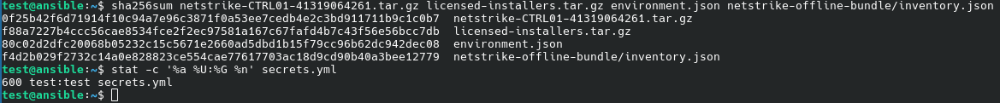

*Hashes identify the tested inputs; `secrets.yml` is mode 600. No secret values are shown.*

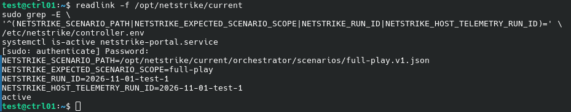

*Confirms the deployed full-play scenario, active portal, and matching portal/host telemetry run ID `2026-11-01-test-1`.*

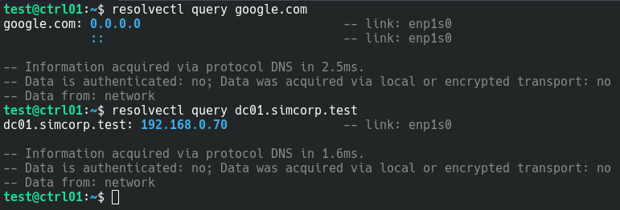

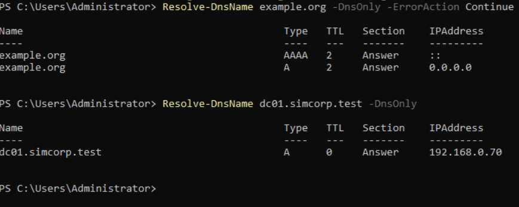

*Both checks show external DNS blocking while internal name resolution works.*

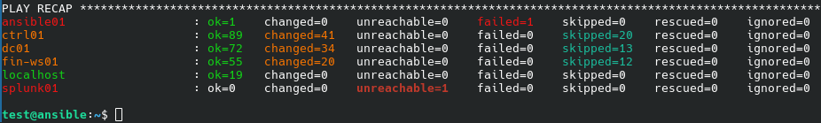

*CTRL01, DC01, and FIN-WS01 completed with no failed tasks. ANSIBLE01 reports one failure and splunk01 is unreachable.*

</details>

<details>
<summary>Facilitator, host, AD, and fixture baseline</summary>

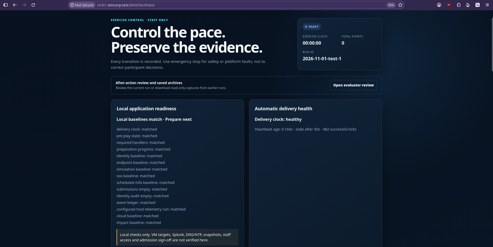

*Local application checks match and delivery is healthy for run `2026-11-01-test-1`; this is not a check of external targets or admission.*

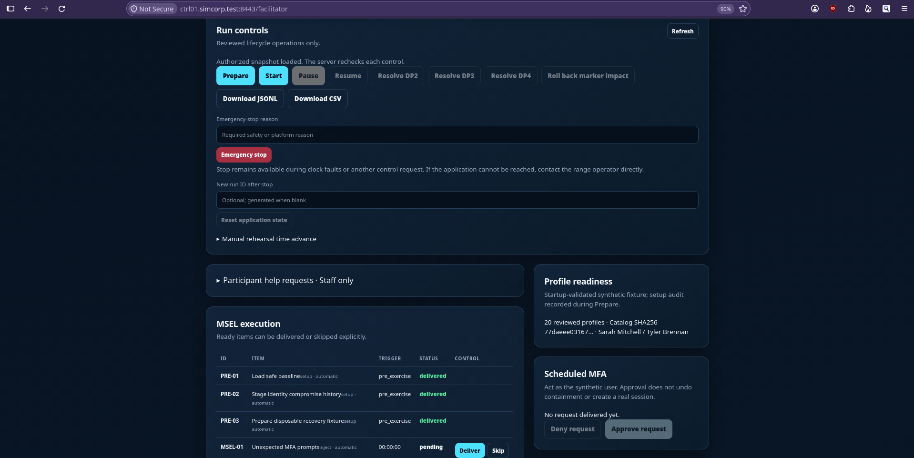

*PRE-01/02/03 are delivered and MSEL-01 is pending; scheduled MFA has no request yet.*

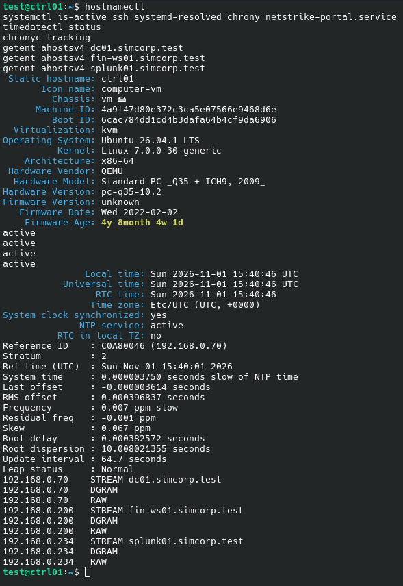

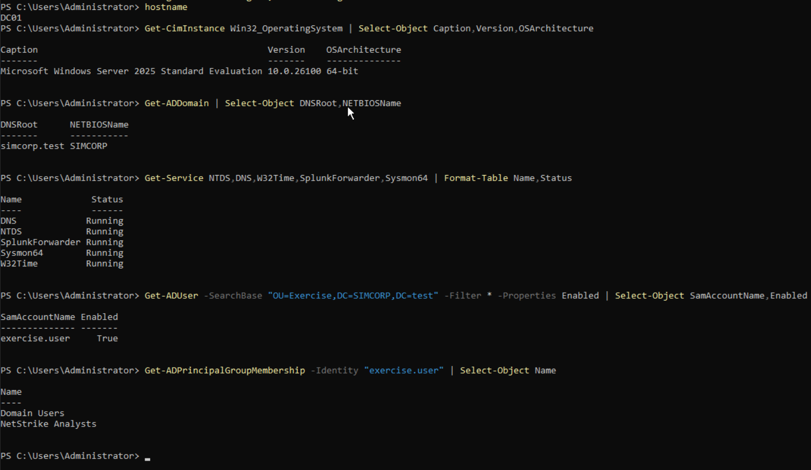

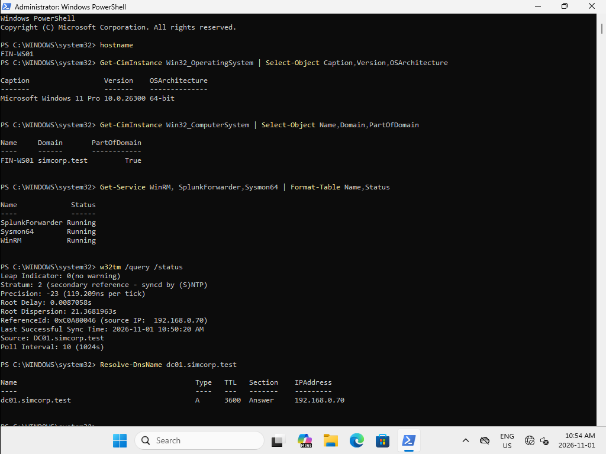

*These captures show the host, service, domain, and time checks recorded for each system.*

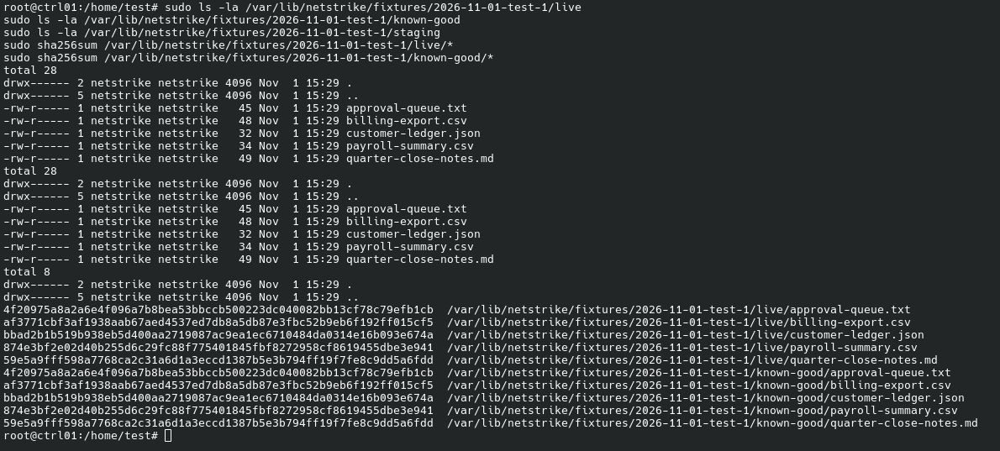

*All five files appear in `live` and `known-good` with matching hashes; `staging` is empty.*

</details>

<details>
<summary>Telemetry, participant access, and run correlation</summary>

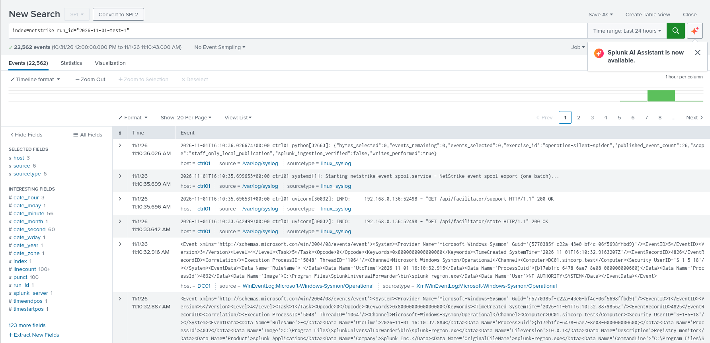

*Participant search returns 22,562 `netstrike` events for run `2026-11-01-test-1` in the displayed time range.*

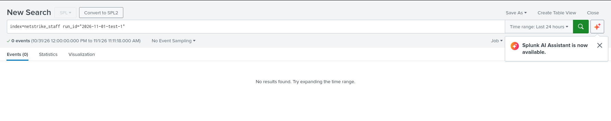

*The participant search returns zero `netstrike_staff` events for run `2026-11-01-test-1`.*

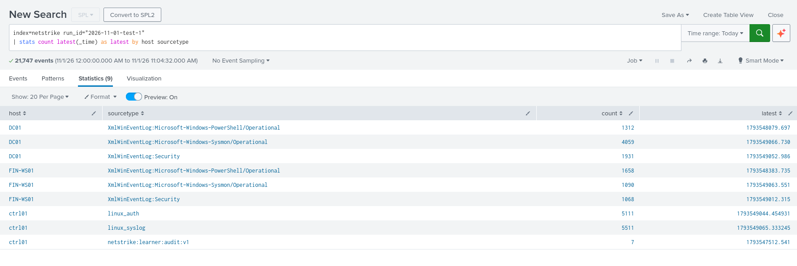

*The run-1 summary reports 21,747 events across nine host/sourcetype rows for CTRL01, DC01, and FIN-WS01.*

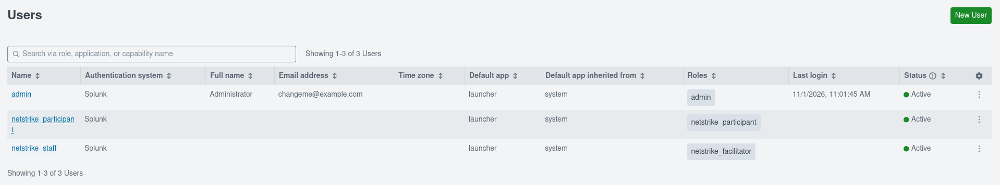

*Shows the participant and facilitator accounts with their assigned NetStrike roles.*

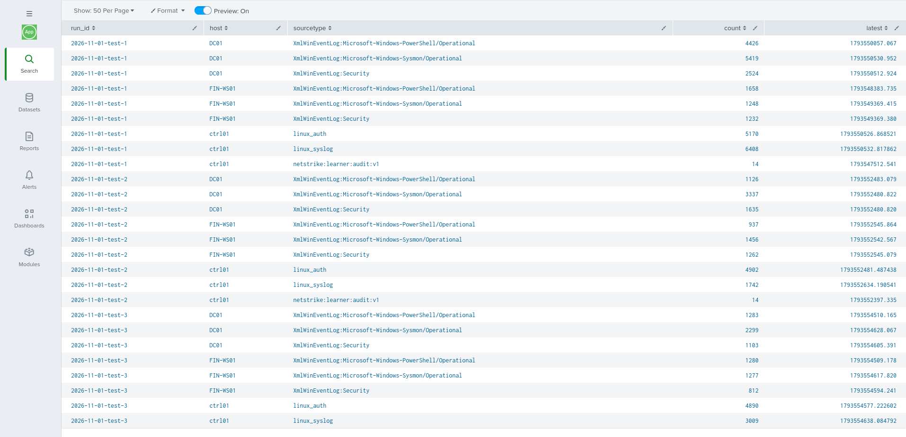

*Shows telemetry for `2026-11-01-test-1`, `-test-2`, and `-test-3` from CTRL01, DC01, and FIN-WS01, corroborating the three test runs.*

</details>

<details>
<summary>Readiness failure, emergency stop, and preflight</summary>

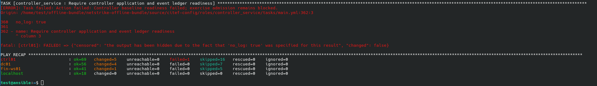

*The controller readiness task fails and reports that exercise admission remains blocked.*

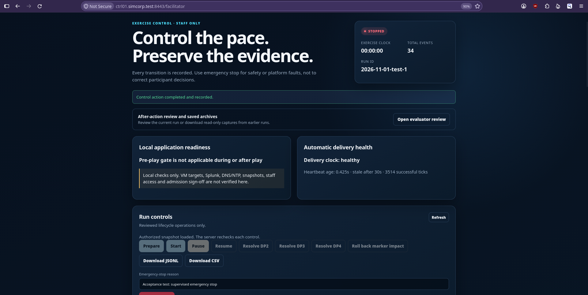

*Shows run `2026-11-01-test-1` stopped with the supervised-test reason and a recorded control-action confirmation.*

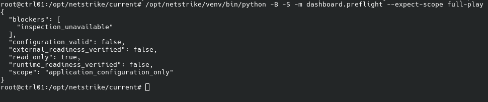

*Preflight reports `inspection_unavailable`, `configuration_valid: false`, and read-only mode.*

</details>

# Offline bundle and provisioning validation — 2026-10-21 (historical)

**Operator:** Patrick  
**Scope:** Local provisioning, telemetry, and restore rehearsal; not CITEF
deployment acceptance.

**Acceptance clarification (Patrick, 2026-10-31):** The Cyber Range has already
delegated full control of exercise VM allocations, images, sizing, addresses,
DNS/NTP, firewall rules, management paths, and participant access to the team.
No additional range configuration approval is outstanding. Patrick accepts this
October 21 provisioning/deployment test and its DNS blocking as sufficient #79
offline provisioning/isolation evidence for the tested configuration. DNS
blocking is the accepted project evidence standard, not proof that direct-IP
or every other Internet-egress path was technically blocked. Do not request a
replacement isolation test solely to close #79. Preserve tested-version/bundle
identity with this record; later changed candidates do not inherit its results.

## Final layout and environment

- `ANSIBLE01` and `CTRL01` are Ubuntu Server 26.04.1 LTS amd64 VMs.
- `FILE01` is the logical file/fixture service on `CTRL01`, not a separate VM.
- `DC01` is Windows Server 2025 Evaluation Version, build 26100.32230.
- `FIN-WS01` is Windows 11 Pro 26H2, build 2300.9457.
- `SPLUNK01` is supplied by the Cyber Range. Local rehearsal used Docker-hosted
  Splunk rather than an independently managed Splunk VM.
- Use the addresses, DNS, NTP, and management paths recorded in the
  [network diagrams](../network-diagram/network-diagram.puml) and the corresponding
  [local diagram](../network-diagram/network-diagram-local.puml). The team selects
  actual allocations under delegated authority; local examples are not proof of
  deployed values.

The offline bundle contains its application dependencies, so provisioning is
not tied to a particular available OS image. The team has its own ISO images if
needed; the team selects images and sizing. Zian/Julien can assist if required.

## Preparation and transfer

- Switched the Windows VM network to Private and enabled WinRM with
  `winrm quickconfig` as administrator. Set root passwords on the Linux VMs
  using `sudo passwd root`.
- Capture the clean snapshot after each target has its OS installed and remote
  management configured (SSH/WinRM), but before running the Ansible playbook.
  This preserves the management path while keeping Ansible-applied baseline
  and telemetry configuration out of the clean starting point. This replaces
  the earlier assumption that snapshots follow baseline and telemetry checks.
- Blocked DNS requests going out to the Internet. Patrick accepts this as
  sufficient isolation evidence for #79's October 21 offline deployment test.

Download the offline bundle from GitHub and transfer it by USB to the designated
Ansible host. Copy `secrets.example.yml` to a private secrets file, fill in the
approved values, and pass that file to `provision.sh`. Keep credentials out of
Git, screenshots, logs, and issue comments. The local rehearsal used `scp`;
USB is the planned range transfer method.

For this rehearsal, the licensed Sysmon and Universal Forwarder installers
were packaged in `licensed-installers.tar.gz`; `local.environment.json` and the
private secrets file were prepared from their examples and adapted to the
personal network and Docker-hosted Splunk.

The script was run with the offline bundle, licensed-installers archive,
environment file, private secrets file, a test deployment version, and a test
exercise run ID:

```sh
./provision.sh <offline-bundle.tar.gz> licensed-installers.tar.gz \
  environment.json secrets.yml <deployment-version> <exercise-run-id>
```

Credentials were test-only; literal values are intentionally omitted.

## Results and limitations

- The Ansible recap succeeded for `CTRL01`, `DC01`, and `FIN-WS01`. The
  `SPLUNK01` unreachable result is expected in this local setup: Splunk ran in a
  Docker container rather than as a separately managed VM. The first supplied
  screenshot records the play recap.
- Windows hosts joined the exercise domain and used DC01 for DNS/NTP. The
  portal passed its startup readiness checks.
- Splunk search of `index="netstrike"` showed telemetry from `CTRL01`, `DC01`,
  and `FIN-WS01` with `run_id=test2-2026-10-21`; the second supplied screenshot
  shows the events and run ID.
- On October 21, snapshot restore and provisioning/readiness were exercised
  three times, but not in consecutive cycles because shared test hardware
  caused instability and multi-minute provisioning delays. The November 1
  three-consecutive-cycle result supersedes that earlier status.
- The separate Ansible `readiness.yml` playbook checks deployment readiness, and portal
  startup performs its own local preflight/readiness gate. A failed startup
  check prevents the application from starting; actionable blocker evidence is
  available in the logs. The provisioning wrapper does not invoke that separate
  playbook. Neither local check alone authorizes participant admission.
- The range operator performs hypervisor snapshot restoration; Patrick
  coordinates the exercise restore/readiness workflow. Escalate an unavailable
  or failed restore/readiness result to Zian/Julien and do not admit
  participants.
- The offline provisioning/isolation evidence is accepted for the tested
  configuration, and the November 1 three-consecutive-cycle criterion is met.
  Docker-hosted Splunk and local rehearsal evidence do not by themselves
  establish the distinct full-play Cyber Range rehearsal/sign-off required by
  #104.

## Existing evidence to reuse

### November 4 telemetry readiness and alert evidence

Patrick supplied two live Splunk screenshots, preserved with the
[evidence comment on #35](https://github.com/Netstrike-development-team/NetStrike_Capstone_17/issues/35#issuecomment-6647480971).


| Status | Count | Recorded evidence |
| --- | --- | --- |
| `OK` | 20 | Includes required application-readiness, identity-action-adapter, identity-slice-automation, scenario-controller, Windows Security and Sysmon; also cloud simulation, impact reset and review archive |
| `IDLE` | 3 | Optional exercise-clock-supervisor: 4374.275 seconds against 3600; helpdesk-simulator: 4197.515 against 3600; linux_auth: 1454.878812 against 900 |
| `NOT_SEEN` | 1 | Optional objective-evaluator; objective judgment was intentionally not performed yet |
| `STALE` | 1 | Required windows_powershell: 929.403 seconds against a 900-second limit |

There are no `MISSING` or `UNMAPPED` rows. The operator intentionally demonstrated
optional-source age expiry and required-source staleness. Optional inactivity
correctly remains nonblocking; mandatory staleness is correctly flagged. This is
a controlled failure-detection demonstration, not an all-healthy readiness pass.


The second screenshot shows **NetStrike Health - Source freshness**, triggered
at **2026-11-04 20:50:01 EST**, in `netstrike_staff`, with **Type: Scheduled**,
**Severity: High**, **Mode: Digest**, and a **View Results** action.

Together these establish source-status classification and live scheduled alert
triggering in the tested deployment. The trigger screenshot does not show its
underlying result rows, so it does not independently identify which source(s)
triggered that later execution. Neither screenshot proves email/webhook delivery,
an all-healthy recovery, per-source run-ID correlation, or full-exercise acceptance
under #104/#86. Inspect the result rows using
[Activity > Triggered Alerts > View Results](../../splunk/README.md#view-triggered-alerts).

Original supplied PNG SHA-256 hashes:

```text
a7bcd859cd3c739d5e2b6839567cf1d904ff26c756f1c0548b1f172b3e13f353  source-overview.png
bec3f1cd6ebb49faff594dc24b28fb48b1c2864dcfa49d198f166cbfccab06d7  triggered-alert.png
```

### Earlier provisioning and ingestion evidence

Use [the October 21 #103 comment and its two screenshots](https://github.com/Netstrike-development-team/NetStrike_Capstone_17/issues/103#issuecomment-6319080151)
rather than requesting the same provisioning and ingestion evidence again:

- The recap shows `CTRL01`, `DC01`, `FIN-WS01`, and `localhost` with zero failed
  tasks. It also shows skipped tasks; it is not an itemized complete-baseline
  report. `SPLUNK01` is unreachable in this Docker-hosted local setup.
- The Splunk screenshot shows `index="netstrike"`, 17,902 events, three host
  values, and visible DC01/FIN-WS01 Sysmon events tagged
  `run_id=test2-2026-10-21`. The comment records CTRL01 as the third host.
  It establishes live ingestion for that test, not all application-event or
  participant-role checks.
- The [October 16 #102 comments](https://github.com/Netstrike-development-team/NetStrike_Capstone_17/issues/102)
  already record source-health, volume, fresh Splunk redeploy, and participant
  separation: the participant-only role can search `netstrike` but sees no
  `netstrike_staff` events. They also confirm index-creation authority covers
  `netstrike_staff`. Do not reopen configuration permission or those recorded
  local checks as missing; distinguish any changed-source or delivery-run checks.

## Baseline evidence to capture

For a fresh campaign, capture the deployment identity, detailed readiness,
host/AD baseline, fixture baseline and recovery, telemetry/access checks,
controlled safety failures, and each restore/reprovision cycle. Keep original
logs, exports, and hashes in staff-controlled storage outside restored VMs.

For each capture, label the test date, deployed source/version, exercise/run ID,
and restore-cycle number. Keep original logs/exports and hashes alongside the
screenshots in staff-controlled storage outside restored VMs. Screenshots are
readable summaries, not replacements for the detailed check results.

| Screenshot | What must be visible | Existing evidence / remaining detail |
|---|---|---|
| Deployment identity | Tested bundle/source revision, archive and inventory SHA-256, deployment version, scenario selection and shared portal/forwarder run ID; omit secret values | Add a receipt to the existing October 21 record, not an invented historical hash or a mandatory replacement provisioning run |
| Full-play portal readiness | Staff readiness report before Prepare and again after Prepare, showing `scope=local_application_only`, `ready_to_prepare`, `ready_to_start`, blockers, and individual baseline checks | Startup was reported as passing; capture the detailed checks, including identity, endpoint, SSO/MFA, cloud, impact, submissions and ledger. PRE-03's one armed synthetic task is expected after Prepare |
| Host/AD baseline | Itemized checks for host names/OS, required services, DNS, measured clock skew/time sync; AD domain, expected users, enabled states and memberships | October 21 recap is already supplied; add the per-check results that it cannot show, not another recap alone |
| FILE01 fixture baseline and recovery | All five live and `known-good` filenames with matching expected SHA-256; empty `staging`; after impact/recovery, the originals restored and impact artifacts removed | Full-play creates these on CTRL01, not a separate FILE01 VM. Capture `approval-queue.txt`, `billing-export.csv`, `customer-ledger.json`, `payroll-summary.csv`, and `quarter-close-notes.md`; do not create or repair fixtures manually to make a check pass |
| Telemetry/run boundary | Source-health results and required source/run correlation, plus raw canonical and learner comparison receipts if not already retained | Reuse #103 ingestion and #102 access/health evidence. Add only missing application-source/export details; a staff search alone does not prove participant access |
| Participant role assignment, if absent | Participant assigned only `netstrike_participant`, with no built-in `user` role | #102 already includes allowed/forbidden search screenshots; its October 16 update says the corrected role-assignment screenshot was not attached |
| Safety failure and admission block | Failed dependency/readiness check with actionable blocker, rejected Prepare/Start or recorded staff admission refusal; authenticated emergency Stop with stopped/cancelled actions and preserved audit evidence | Capture a controlled disposable test; do not expose tokens or use production credentials. Escalation/restore failure can also be recorded in a staff incident record |
| Three consecutive restores | Snapshot identifiers captured after OS/SSH/WinRM and before Ansible; each cycle's restore, new shared run ID, reprovision and complete readiness/baseline result | **Met:** the November 1 report records three consecutive clean-snapshot restore/reprovision/readiness cycles (owner clarification, 2026-11-04). Preserve the detailed cycle records with the evidence; do not repeat cycles solely to satisfy this criterion |

Application readiness covers local synthetic state, including identity
sessions/factors, mock-cloud state, and fixture integrity. AD checks cover the
actual configured domain baseline. Keep both: neither is a substitute for the
other or for staff validation of emergency-stop reachability and admission.
Redact credentials, tokens, keys, private range configuration values, and
unrelated host data from public evidence; retain detailed records privately.

# Offline bundle and provisioning validation — 2026-10-15

**Operator:** Patrick  
**Scope:** Local provisioning rehearsal on the configured test VMs; not CITEF
deployment acceptance.

## Environment and preparation

- Created a Windows 11 26H2 `FIN-WS01`, an Ubuntu 26.04.1 `CTRL01`, and a
  separate Ubuntu 26.04.1 Ansible host. Personal-LAN addresses and the local
  environment manifest are intentionally not recorded here.
- Used existing personal-network DNS and NTP services instead of `DC01`.
- Switched the Windows VM network to Private and enabled WinRM with
  `winrm quickconfig` as administrator. Set root passwords on the Linux VMs
  using `sudo passwd root`.
- Captured snapshots of the blank VM states. This run did not test restoring
  those snapshots.
- Blocked DNS requests going out to the Internet. The October 31 acceptance
  clarification above accepts DNS blocking as #79 isolation evidence; it does
  not retroactively change this earlier run's host failures or restore scope.

## Offline transfer and provisioning

Downloaded the CTRL01 offline bundle and `scripts/provision.sh` from GitHub,
packaged the licensed Sysmon and Universal Forwarder installers in
`licensed-installers.tar.gz`, and prepared local `environment.json` and
`secrets.yml` from the example files. The environment values were adjusted for
the personal network and Docker-hosted Splunk. The files were copied to the
Ansible host with `scp`; USB is the planned transfer method in the Cyber Range.

Ran the script with the offline bundle, licensed-installers archive, environment
file, secrets file, a test deployment version, a test exercise run ID, and `external-ntp=true`:

```sh
./provision.sh <offline-bundle.tar.gz> licensed-installers.tar.gz \
  environment.json secrets.yml <deployment-version> <exercise-run-id> true
```

The credentials were test-only and supplied through the local secrets file;
their literal values are intentionally omitted from this record and the linked
GitHub issue comments.

## Result and limitations

- The Ansible summary reported two host failures, for `DC01` and the Splunk
  Server. Neither host was being configured in this test; these results do not
  establish that either host was provisioned or ready.
- Ansible warnings caused by use of `su` were reported as harmless.
- The test used existing network DNS/NTP and did not exercise `DC01`, Splunk
  Server configuration, or snapshot restoration.
  It is therefore a scoped provisioning rehearsal, not proof of full offline
  readiness, telemetry acceptance, or restore acceptance.
